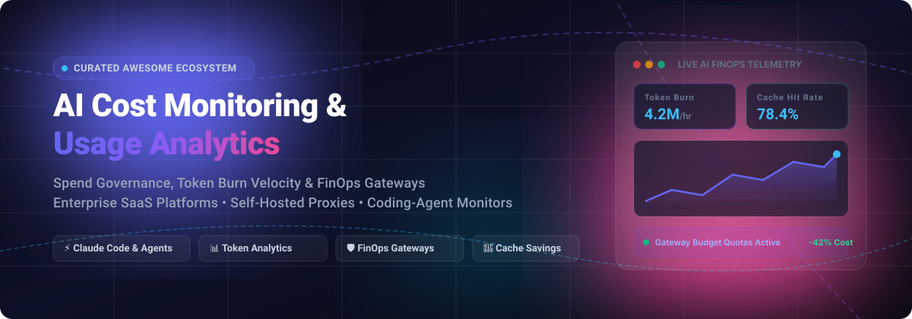

<p align="center">
  
</p>

# Awesome AI Cost Monitoring & Usage Analytics 💸📊

> A curated list of leading **SaaS platforms** and active **open-source projects** for **AI Cost Monitoring**, **LLM Observability**, **Token Burn Analytics**, **AI FinOps Gateways**, and **Coding-Agent Usage Tracking** (`Claude Code`, `Cursor`, `OpenAI`, `Anthropic`).

<p align="center">
  <a href="https://github.com/ishandutta2007/Awesome-Awesome-Awesome"></a>
  <a href="https://discord.gg/jc4xtF58Ve"></a>
  <a href="https://github.com/ishandutta2007/Awesome-Awesome-Awesome"></a>
  <a href="https://github.com/ishandutta2007/Awesome-AI-Cost-Monitoring-Usage-Analytics/stargazers"></a>
  <a href="https://github.com/ishandutta2007/Awesome-AI-Cost-Monitoring-Usage-Analytics/blob/main/README.md"></a>
  <a href="https://creativecommons.org/publicdomain/zero/1.0/"></a>
  <a href="https://github.com/ishandutta2007"></a>
</p>

---

## 🧭 Overview & Architecture

Modern AI applications, multi-agent systems, and AI coding assistants consume millions of tokens daily across heterogeneous model providers (OpenAI, Anthropic Claude, Google Gemini, AWS Bedrock, Mistral, and local LLMs like Ollama/vLLM). Managing inference costs, enforcing tenant-level quota caps, avoiding sudden bill shocks, and tracking sub-agent token burn velocity require specialized **AI FinOps & Usage Analytics** infrastructure.

This repository tracks:
- 🛡️ **Unified AI Gateways & Routers**: Reverse proxies offering multi-provider fallback, virtual API keys, budget enforcement, and semantic prompt caching.
- 📈 **LLM Observability & Cost Rollup Platforms**: Tracing platforms calculating exact prompt/completion token expenditures down to individual user sessions, agents, and spans.
- ⚡ **Coding-Agent Usage Monitors**: CLI/TUI tools and status bar monitors tracking rolling quotas, session limits, and burn velocity for tools like Claude Code and Cursor.

---

## 📑 Table of Contents

- [🌐 Sector Overview & Market Dynamics](#-sector-overview--market-dynamics)
- [☁️ SaaS / Hosted Platforms](#️-saas--hosted-platforms)
- [💻 Open-Source GitHub Projects](#-open-source-github-projects)
  - [⭐ Top Open-Source Projects (Ranked by Stars)](#-top-open-source-projects-ranked-by-stars)
  - [⚡ Specialized Coding-Agent & CLI Monitors](#-specialized-coding-agent--cli-monitors)
  - [🧮 Token Counters & Cost Calculation Libraries](#-token-counters--cost-calculation-libraries)
- [🏗️ Architecture & Common FinOps Stacks](#️-architecture--common-finops-stacks)
- [🤝 How to Contribute](#-how-to-contribute)
- [💖 Support & Community](#-support--community)
- [📊 Star History](#-star-history)
- [📜 Disclaimer & License](#-disclaimer--license)

---

## 🌐 Sector Overview & Market Dynamics

The global AI and LLM observability market is estimated at approximately **$1.4B–$1.8B in 2026** and projected to surpass **$7B–$9B+ by 2030** (growing at a 32–36% CAGR), driven by enterprise transitions from experimental pilots to production agentic workflows and multi-LLM deployments. 

The sector is currently **moderately to highly fragmented**: established observability giants (e.g., Datadog, Cloudflare) dominate enterprise-wide network and APM budgets, while AI-native challengers and open-source gateway/observability disruptors (e.g., LiteLLM, Langfuse/ClickHouse, Portkey/Palo Alto Networks, Helicone) capture specialized LLM engineering workflows, preventing a single winner-take-all consolidation in the near term.

---

## ☁️ SaaS / Hosted Platforms

The table below lists notable hosted and enterprise SaaS platforms for AI cost monitoring, token analytics, and gateway management, **sorted descending by company size / market valuation**:

| Platform | Company Size (Valuation / Revenue) | Starting Paid Pricing | Free Tier / Trial Limit | Key FinOps & Cost Monitoring Capabilities |
| :--- | :--- | :--- | :--- | :--- |
| **[Cloudflare AI Gateway](https://cloudflare.com)** | **~$69B Market Cap** (NYSE: NET) | **$5/month** (Workers Paid base) | **Free forever** (Up to 100,000 requests/day & 100k logs; no per-request gateway fee with BYOK) | Managed edge proxy sitting between apps and AI providers; unified request metrics, token/cost estimation, response caching, and rate limiting. |
| **[Datadog LLM Observability](https://datadoghq.com)** | **~$48B Market Cap** (NASDAQ: DDOG) | **$160/month** (Includes 100,000 LLM spans; +$3.50–$7.50 per 10k additional spans) | **Free forever** (Up to 40,000 LLM spans/month included at no cost) | Full-stack enterprise APM and LLM observability tracking end-to-end multi-agent traces, token consumption, operational spend, latency, and drift. |
| **[Martian](https://withmartian.com)** | **~$1.3B Valuation** ($18M+ raised from NEA, Prosus, Accenture) | **Usage-based** (Billed per million tokens routed across 200+ models) | **Developer Sandbox Access** (Free test queries & sandbox credits upon account setup) | Dynamic model-routing engine dispatching prompts to the most cost-effective LLM capable of meeting target performance benchmarks. |
| **[Portkey](https://portkey.ai)** | **$140M Valuation** (Acquired by Palo Alto Networks; $18M VC raised) | **$49/month** (Production plan; includes 100,000 logs/mo, +$9 per extra 100k logs) | **Free forever** (Developer plan: 10,000 recorded logs/month, 3-day log retention, unlimited proxy routing) | Enterprise AI gateway suite with virtual keys, granular budget caps, automatic fallback routing, semantic caching, and unified FinOps dashboards. |
| **[Langfuse Cloud](https://langfuse.com)** | **$40M–$60M Est. Valuation** (Acquired by ClickHouse; $4.5M seed raised) | **$29/month** (Core plan; includes 100,000 units/mo, +$8 per 100k extra units) | **Free forever** (Hobby plan: 50,000 billable units/month, 2 user seats, 30-day retention) | Managed cloud deployment of open-source LLM engineering platform; automated model pricing tables, trace- and session-level cost rollups. |
| **[Helicone](https://helicone.ai)** | **$25M Valuation** ($5M Seed raised from YC, Village Global; ~$1M ARR) | **$79/month** (Pro plan; includes unlimited seats, alerts, and custom properties) | **Free forever** (Hobby plan: 10,000 requests/month, 1 GB storage, 1 seat, 7-day data retention) | Proxy-based AI gateway offering real-time token metering, per-user/customer spend attribution, semantic caching savings reports, and budget alerts. |
| **[Keywords AI (Respan)](https://keywordsai.co)** | **~$20M–$25M Est. Valuation** ($5M Seed raised from Gradient Ventures, YC) | **$7/user/month** (Pro starter tier + usage-based gateway volume) | **Free forever** (Starter allowance with ~2,000 free request logs & playground credits) | Unified LLM gateway delivering single OpenAI-compatible endpoint with real-time cost breakdown, latency analytics, user spend limits, and caching. |
| **[PromptLayer](https://promptlayer.com)** | **~$15M–$20M Est. Valuation** ($4.8M Seed raised from ScOp, Stellation) | **$49/month** (Pro plan; baseline request allowance + pay-as-you-go overages) | **Free forever** (Free plan: ~2,500 requests/month, 10 stored prompt templates, 250 eval cell runs) | Prompt management and LLM analytics platform offering request history logging, token-per-template cost breakdowns, and A/B test evaluations. |
| **[BerriAI (LiteLLM Cloud / Enterprise)](https://litellm.ai)** | **~$10M–$15M Est. Valuation** ($1.6M Seed raised from YC, Gravity Fund) | **Custom Enterprise contract** (Starts ~$250/mo for base enterprise support; OSS is $0) | **30-Day Free Trial** (Full Enterprise feature trial key; core proxy is 100% free forever self-hosted) | Managed enterprise governance for LiteLLM Proxy with centralized spend policies, team chargebacks, SSO/SCIM, and multi-provider quota enforcement. |

---

## 💻 Open-Source GitHub Projects

Open-source tools offer complete data privacy, zero vendor lock-in, and self-hosted control plane governance.

### ⭐ Top Open-Source Projects (Ranked by Stars)

Each project includes a live GitHub Stars_Count badge linked directly to its stargazers page, sorted in descending order:

1. **[Ollama](https://github.com/ollama/ollama)** [](https://github.com/ollama/ollama/stargazers) 🦙  
   Get up and running with Llama 3, Mistral, and other local models. Eliminates per-token cloud API inference costs with Prometheus-compatible token throughput and performance metrics.
   * *License*: MIT | *Language*: Go

2. **[vLLM](https://github.com/vllm-project/vllm)** [](https://github.com/vllm-project/vllm/stargazers) ⚡  
   High-throughput and memory-efficient LLM serving engine with PagedAttention. Provides native Prometheus metrics for generation token counts, prompt throughput, and GPU utilization for on-premise FinOps.
   * *License*: Apache-2.0 | *Language*: Python / C++

3. **[LiteLLM Proxy (`BerriAI/litellm`)](https://github.com/BerriAI/litellm)** [](https://github.com/BerriAI/litellm/stargazers) 🛡️  
   Leading open-source AI gateway providing a single OpenAI-compatible proxy format across 100+ LLMs. Features virtual key management, user/team budget caps, spend tracking, rate-limiting, and load balancing.
   * *License*: MIT | *Language*: Python

4. **[New-API (`QuantumNous/new-api`)](https://github.com/QuantumNous/new-api)** [](https://github.com/QuantumNous/new-api/stargazers) 🔑  
   High-performance multi-provider LLM key aggregation and billing gateway (fork of One-API) supporting model routing, token quota distribution, user groups, and granular consumption logs.
   * *License*: MIT | *Language*: Go / JavaScript

5. **[Langfuse (`langfuse/langfuse`)](https://github.com/langfuse/langfuse)** [](https://github.com/langfuse/langfuse/stargazers) 🔭  
   Self-hostable LLM engineering and observability platform featuring customizable model token pricing tables, hierarchical trace/session cost aggregation, and detailed user consumption dashboards.
   * *License*: MIT / FSL | *Language*: TypeScript

6. **[One-API (`songquanpeng/one-api`)](https://github.com/songquanpeng/one-api)** [](https://github.com/songquanpeng/one-api/stargazers) 🎫  
   Widely adopted multi-model API gateway with integrated billing, token quota balance management, redemption codes, and rate limiting across commercial and open-source models.
   * *License*: MIT | *Language*: Go / JavaScript

7. **[Promptfoo (`promptfoo/promptfoo`)](https://github.com/promptfoo/promptfoo)** [](https://github.com/promptfoo/promptfoo/stargazers) 🧪  
   CLI and CI/CD evaluation and security testing framework for LLMs that automatically reports prompt cost, token counts, and latency per test run alongside quality and safety evals.
   * *License*: MIT | *Language*: TypeScript

8. **[Opik (`comet-ml/opik`)](https://github.com/comet-ml/opik)** [](https://github.com/comet-ml/opik/stargazers) 🔬  
   Open-source platform to track, trace, evaluate, and monitor LLM applications from local development to production with built-in per-trace token and cost analytics.
   * *License*: Apache-2.0 | *Language*: Python / TypeScript

9. **[ccusage (`ccusage/ccusage`)](https://github.com/ccusage/ccusage)** [](https://github.com/ccusage/ccusage/stargazers) 📊  
   Ultra-fast CLI analyzer for parsing local Claude Code JSONL logs to display daily, monthly, and session-level token usage, prompt cache hit ratios, and estimated USD spend.
   * *License*: MIT | *Language*: TypeScript

10. **[Portkey AI Gateway (`Portkey-AI/gateway`)](https://github.com/Portkey-AI/gateway)** [](https://github.com/Portkey-AI/gateway/stargazers) 🚪  
    Blazing-fast (sub-millisecond overhead) AI gateway written in TypeScript. Implements multi-provider routing, automated retries, fallback handling, and budget metadata headers.
    * *License*: MIT | *Language*: TypeScript

11. **[Phoenix (`Arize-ai/phoenix`)](https://github.com/Arize-ai/phoenix)** [](https://github.com/Arize-ai/phoenix/stargazers) 🔥  
    AI observability platform for tracing, evaluations, and dataset curation with built-in OpenTelemetry instrumentation for token spend attribution and latency monitoring.
    * *License*: Apache-2.0 | *Language*: Python / TypeScript

12. **[TensorZero (`tensorzero/tensorzero`)](https://github.com/tensorzero/tensorzero)** [](https://github.com/tensorzero/tensorzero/stargazers) ⚙️  
    High-performance LLM gateway and optimization engine written in Rust. Features ClickHouse-backed token analytics, latency tracing, dynamic routing, and model evaluation.
    * *License*: Apache-2.0 | *Language*: Rust

13. **[Bifrost (`maximhq/bifrost`)](https://github.com/maximhq/bifrost)** [](https://github.com/maximhq/bifrost/stargazers) 🌈  
    High-throughput AI gateway built in Go featuring virtual API key management, budget guardrails, fallback routing, and OpenTelemetry usage telemetry.
    * *License*: Apache-2.0 | *Language*: Go

14. **[Maciek-roboblog/Claude-Code-Usage-Monitor](https://github.com/Maciek-roboblog/Claude-Code-Usage-Monitor)** [](https://github.com/Maciek-roboblog/Claude-Code-Usage-Monitor/stargazers) 🖥️  
    Interactive terminal TUI dashboard built with Rich monitoring Claude Code token burn velocity, rolling 5-hour quota reset countdowns, and predictive exhaustion warnings.
    * *License*: MIT | *Language*: Python

15. **[GPTCache (`zilliztech/GPTCache`)](https://github.com/zilliztech/GPTCache)** [](https://github.com/zilliztech/GPTCache/stargazers) 💾  
    Semantic caching library for LLM queries that intercepts repetitive prompts and serves vector-matched completions, slashing token expenditure by up to 80%.
    * *License*: MIT | *Language*: Python

16. **[OpenLLMetry (`traceloop/openllmetry`)](https://github.com/traceloop/openllmetry)** [](https://github.com/traceloop/openllmetry/stargazers) 📐  
    OpenTelemetry-standard extensions exporting structured `gen_ai.usage.input_tokens`, `output_tokens`, and cost metrics to Prometheus, Grafana, Datadog, or New Relic.
    * *License*: Apache-2.0 | *Language*: Python / TypeScript / Go

17. **[Helicone (`Helicone/helicone`)](https://github.com/Helicone/helicone)** [](https://github.com/Helicone/helicone/stargazers) 🛸  
    Open-source LLM observability proxy and FinOps suite enabling self-hosted request logging, prompt caching savings tracking, rate limiting, and custom cost alerts.
    * *License*: Apache-2.0 | *Language*: TypeScript

18. **[RouteLLM (`lm-sys/RouteLLM`)](https://github.com/lm-sys/RouteLLM)** [](https://github.com/lm-sys/RouteLLM/stargazers) 🚦  
    LMSYS framework for training and deploying cost-aware LLM routers that dynamically route simpler prompts to cheaper models while maintaining response quality.
    * *License*: Apache-2.0 | *Language*: Python

19. **[Cognita (`truefoundry/cognita`)](https://github.com/truefoundry/cognita)** [](https://github.com/truefoundry/cognita/stargazers) 🧠  
    RAG framework with modular architecture featuring Langfuse/OpenLIT integrations for end-to-end retrieval cost tracking and token usage auditing.
    * *License*: Apache-2.0 | *Language*: Python

20. **[OpenLIT (`openlit/openlit`)](https://github.com/openlit/openlit)** [](https://github.com/openlit/openlit/stargazers) 💡  
    OpenTelemetry-native AI observability and FinOps platform providing zero-code token and GPU cost monitoring with prebuilt Grafana dashboards.
    * *License*: Apache-2.0 | *Language*: Python

21. **[claude-usage (`phuryn/claude-usage`)](https://github.com/phuryn/claude-usage)** [](https://github.com/phuryn/claude-usage/stargazers) 🍏  
    macOS menu bar utility and CLI tool for tracking Claude Code and Anthropic subscription quota burn, session reset timers, and token usage velocity.
    * *License*: MIT | *Language*: Swift / Shell

22. **[TokenCost (`AgentOps-AI/tokencost`)](https://github.com/AgentOps-AI/tokencost)** [](https://github.com/AgentOps-AI/tokencost/stargazers) 💰  
    Lightweight Python utility library for calculating exact USD prompt and completion costs across 400+ commercial and hosted LLM models.
    * *License*: MIT | *Language*: Python

23. **[BricksLLM (`bricks-cloud/BricksLLM`)](https://github.com/bricks-cloud/BricksLLM)** [](https://github.com/bricks-cloud/BricksLLM/stargazers) 🧱  
    Cloud-native AI gateway written in Go providing API key management, granular spend caps, rate policies, and Prometheus usage telemetry.
    * *License*: MIT | *Language*: Go

24. **[Claude-Code-Agent-Monitor (`hoangsonww/Claude-Code-Agent-Monitor`)](https://github.com/hoangsonww/Claude-Code-Agent-Monitor)** [](https://github.com/hoangsonww/Claude-Code-Agent-Monitor/stargazers) 🤖  
    Web-based real-time dashboard for monitoring Claude Code sub-agent sessions, tool invocations, and token expenditure.
    * *License*: MIT | *Language*: TypeScript / Python

---

### ⚡ Specialized Coding-Agent & CLI Monitors

| Project | GitHub_Stars | Focus & Description |
| :--- | :--- | :--- |
| **[ccusage](https://github.com/ccusage/ccusage)** | [](https://github.com/ccusage/ccusage/stargazers) | CLI log parser for Claude Code sessions; breaks down token counts and caching metrics. |
| **[Claude-Code-Usage-Monitor](https://github.com/Maciek-roboblog/Claude-Code-Usage-Monitor)** | [](https://github.com/Maciek-roboblog/Claude-Code-Usage-Monitor/stargazers) | Real-time Rich terminal UI showing rolling 5-hour quota reset windows and burn velocity. |
| **[claude-usage](https://github.com/phuryn/claude-usage)** | [](https://github.com/phuryn/claude-usage/stargazers) | macOS menu-bar tracker for Claude Pro/Team subscription quota consumption. |
| **[Claude-Code-Agent-Monitor](https://github.com/hoangsonww/Claude-Code-Agent-Monitor)** | [](https://github.com/hoangsonww/Claude-Code-Agent-Monitor/stargazers) | Web dashboard visualizing multi-agent sessions, tool calls, and per-task token cost. |

---

### 🧮 Token Counters & Cost Calculation Libraries

| Library | GitHub_Stars | Purpose |
| :--- | :--- | :--- |
| **[tiktoken (`openai/tiktoken`)](https://github.com/openai/tiktoken)** | [](https://github.com/openai/tiktoken/stargazers) | Fast BPE token counter in Rust/Python for OpenAI models to budget prompt sizes pre-call. |
| **[tokenizers (`huggingface/tokenizers`)](https://github.com/huggingface/tokenizers)** | [](https://github.com/huggingface/tokenizers/stargazers) | High-speed tokenization library supporting modern open-weight architectures (Llama, Mistral). |
| **[TokenCost (`AgentOps-AI/tokencost`)](https://github.com/AgentOps-AI/tokencost)** | [](https://github.com/AgentOps-AI/tokencost/stargazers) | Programmatic lookup utility to calculate USD cost from prompt and completion token counts. |

---

## 🏗️ Architecture & Common FinOps Stacks

A robust AI cost management stack typically combines multiple layers:

```
┌─────────────────────────────────────────────────────────────┐
│                 Client / Coding Agents                      │
│        (Claude Code, Cursor, LangChain, Custom Apps)        │
└──────────────────────────────┬──────────────────────────────┘
                               │
                               ▼
┌─────────────────────────────────────────────────────────────┐
│                   AI Gateway / Routing Layer                │
│    (LiteLLM Proxy / Portkey Gateway / TensorZero / Bifrost) │
│  - Virtual API Keys & Tenant Budgets                        │
│  - Semantic Caching (GPTCache)                              │
│  - Fallback Routing & Rate-Limit Mitigation                 │
└──────────────────────────────┬──────────────────────────────┘
                               │
                               ▼
┌─────────────────────────────────────────────────────────────┐
│               Observability & FinOps Rollup                 │
│      (Langfuse / OpenLIT / Phoenix / Datadog / Opik)        │
│  - OpenTelemetry Trace Collection (OpenLLMetry)             │
│  - Trace-level Cost Attribution & Billing Chargebacks       │
│  - Evaluation & Quality Scoring                             │
└──────────────────────────────┬──────────────────────────────┘
                               │
                               ▼
┌─────────────────────────────────────────────────────────────┐
│                 Inference Providers                         │
│  (OpenAI, Anthropic, Gemini, AWS Bedrock, Ollama, vLLM)    │
└──────────────────────────────┬──────────────────────────────┘
```

1. **Pre-call Budgeting**: Fast token counting with `tiktoken` or `tokenizers` before invoking paid APIs.
2. **Gateway Protection**: Intercept requests with **LiteLLM Proxy** or **Portkey** to enforce hard monthly budget caps per department or virtual API key.
3. **Semantic Caching**: Reduce duplicate prompt spend with **GPTCache** or gateway-level caching.
4. **Trace Attribution**: Export execution spans via **OpenTelemetry / OpenLLMetry** into **Langfuse**, **OpenLIT**, or **Datadog** for granular user/feature cost rollups.
5. **Coding-Agent Monitoring**: Track developer CLI tool quota burn with **ccusage** and **Claude-Code-Usage-Monitor**.

---

## 🤝 How to Contribute

We welcome additions, corrections, and updates from the community!

1. **Fork** this repository.
2. **Add or edit entries** in `README.md` keeping alphabetical or star-ranked consistency.
3. **Ensure criteria are met**:
   - For SaaS: Must include pricing, free tier/trial limits, and company size/funding.
   - For Open-Source: Include GitHub Stars_Badge (`style=social&color=white`) linking to `/stargazers`.
4. **Submit a Pull Request** with a brief summary of the project.

---

## 💖 Support & Community

Thank you for exploring and utilizing this curated ecosystem! If you find this resource valuable for your AI engineering, FinOps, or coding workflows:

- ⭐ **Star this repository** to help others discover it on GitHub.
- 🍴 **Fork and contribute** your favorite tools, gateways, and monitors.
- 📢 **Share it** with fellow AI platform engineers, FinOps teams, and agent builders.
- ☕ **Buy me a coffee / Sponsor**: If you'd like to support continued maintenance and curation of open-source resources, check out the [GitHub Sponsors Dashboard](https://github.com/sponsors/ishandutta2007).

---

##  Star History
[](https://www.star-history.com/#ishandutta2007/Awesome-AI-Cost-Monitoring-Usage-Analytics&type=date&legend=top-left)

---

## 📜 Disclaimer & License

- This is a community-curated list maintained for educational and informational purposes. Mention does not constitute an endorsement.
- Licensed under [Creative Commons Zero v1.0 Universal (CC0-1.0)](https://creativecommons.org/publicdomain/zero/1.0/).
